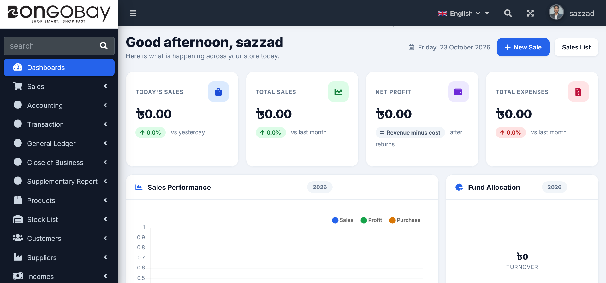
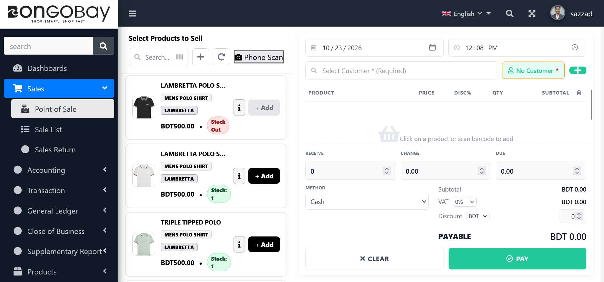
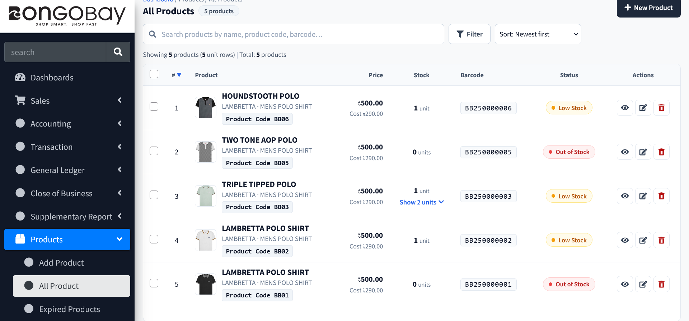
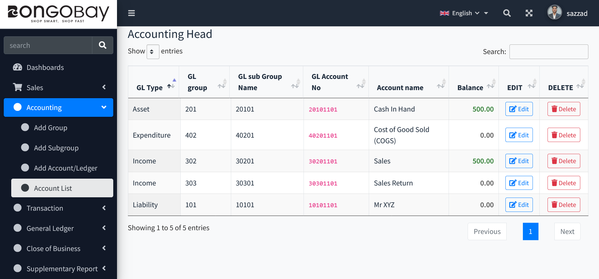
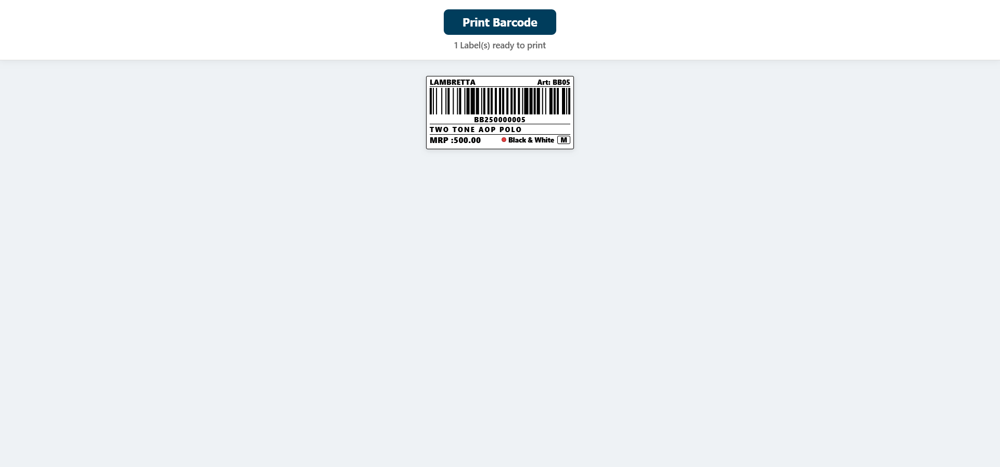

# BongoBay POS & Inventory Management System

<p align="center">
  <a href="https://clothbd.live/login"><strong>View live demo</strong></a>
  &nbsp;·&nbsp;
  <a href="#quick-start">Quick start</a>
  &nbsp;·&nbsp;
  <a href="#feature-highlights">Features</a>
</p>

A full-featured retail operations platform for shops that need one place to sell products, control inventory, manage purchasing, track cash flow, and review business performance. It is built for day-to-day counter sales and back-office administration.

> **Live application:** [clothbd.live/login](https://clothbd.live/login)<br>
> Access is intentionally restricted; request demo credentials from the project owner.

## What it solves

- Creates fast, barcode-assisted counter sales with customers, discounts, VAT, payment methods, receipts, and sale returns.
- Keeps product, variant, unit, supplier, purchase, and stock data connected so teams can see availability before selling.
- Gives owners clear dashboards, profit/loss figures, due tracking, accounting heads, and operational reports.
- Supports role and permission management so staff receive only the access they need.

## Feature highlights

| Area | Included capabilities |
| --- | --- |
| Point of sale | Product search, barcode/phone scanning, customer selection, VAT/discounts, payment capture, receipts, returns |
| Catalog & inventory | Products, brands, categories, colours, sizes, units, variations, stock alerts, expired-product tracking |
| Purchasing | Supplier records, purchases, purchase returns, payable and due tracking |
| Finance & accounting | Income, expenses, payment types, VAT, cash flow, accounting groups and ledger heads |
| Reporting | Sales, purchase, stock, due, VAT, income/expense, transaction history, and profit/loss reports |
| Administration | Authentication, user/role/permission management, configurable menus, bilingual-ready language files |
| Labels | Product barcode generation and printable barcode labels |

## Product tour

### Executive dashboard

At-a-glance sales, profit, expenses, and visual performance reporting let an owner understand store activity immediately.



### Counter-ready point of sale

The POS flow keeps product selection and checkout together, with stock status, barcode scanning, customers, discounts, VAT, payment method, and payable total in one screen.



### Inventory control

The product list exposes price, cost, barcode, stock, product codes, variations, and low/out-of-stock status for fast operational decisions.



### Financial structure

Accounting heads provide organised ledger categories and balances for reliable business reporting.



### Printable barcode labels

Generate clean, store-ready labels containing brand, article code, barcode, pricing, colour, and size information.



## Technology

- **Backend:** PHP 8.2, Laravel 12
- **Frontend:** Blade, AdminLTE, Bootstrap, Tailwind CSS, Vite
- **Database:** MySQL/MariaDB or SQLite for local development
- **Supporting libraries:** DomPDF for documents, Milon Barcode, HTML5 QR/barcode scanning, Spatie permissions

## Quick start

### Requirements

- PHP 8.2 or newer
- Composer
- Node.js and npm
- MySQL/MariaDB (or SQLite for local development)

### Installation

```bash
git clone https://github.com/Hssazzad/Possales-Managment-sytem.git
cd Possales-Managment-sytem

composer install
npm install
copy .env.example .env
php artisan key:generate
```

Configure the database values in `.env`, then run:

```bash
php artisan migrate --seed
npm run build
php artisan serve
```

Open the address printed by Laravel. Never commit the generated `.env` file; it contains local credentials and application secrets.

### Development commands

```bash
# Run the automated test suite
php artisan test

# Format PHP source
vendor/bin/pint --dirty

# Run Laravel, queue worker, and Vite together
composer run dev
```

## Security & repository hygiene

This repository intentionally excludes environment files, runtime uploads, local data, editor/AI settings, and one-off repair/deployment utilities. `.env.example` is retained as the safe configuration template. Before production deployment, use unique application keys, strong passwords, HTTPS, least-privilege database users, and a separate production environment file.

## Project structure

```text
app/            Application controllers, models, services, and business rules
database/       Migrations, factories, and seeders
resources/      Blade views, CSS, and JavaScript source
routes/         Modular web routes by business area
public/         Public assets and web entry point
tests/          Feature and unit tests
docs/           Portfolio screenshots and supporting documentation
```

## License

This project is distributed under the MIT License. See [LICENSE](LICENSE) if included in the repository.
